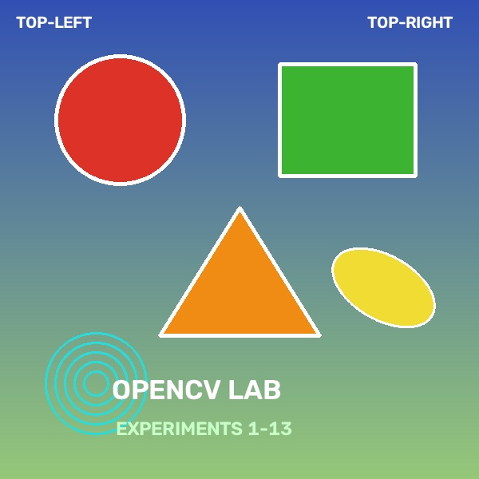
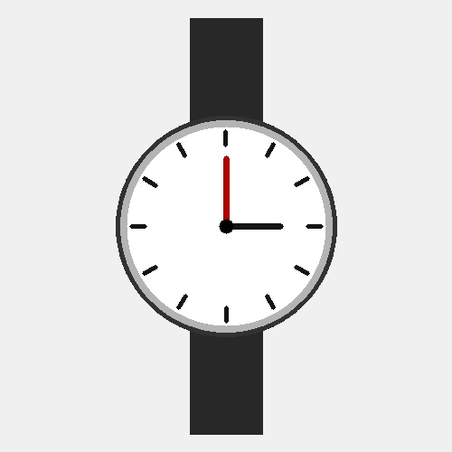
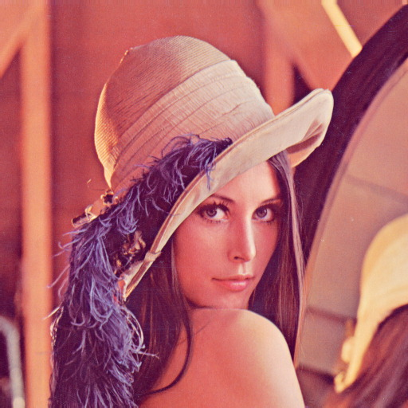

# Computer Vision Laboratory Experiments (1 to 30)

This repository contains the complete laboratory record for **Computer Vision (Experiments 1 to 30)**.
Every experiment is prepared in the official laboratory record format:
- **AIM**
- **PROCEDURE**
- **PROGRAM CODE**
- **INPUT (Source Image)**: Rendered visual input image
- **OUTPUT (Result Image)**: Rendered visual output image
- **INPUT & OUTPUT SIDE-BY-SIDE COMPARISON**
- **RESULT**

Download the complete Word Document record: [Computer_Vision_Lab_Record_All_30_Experiments.docx](Computer_Vision_Lab_Record_All_30_Experiments.docx)

---

## Index of Experiments

| No. | Experiment Title | Python Code | Word Document | Output File |
|:---:|:-----------------|:------------|:--------------|:------------|
| **1** | Perform basic Image Handling and processing operations ... | [`experiment 1.py`](experiment%201.py) | [`experiment 1.docx`](experiment%201.docx) | [`experiment 1_output.jpg`](experiment%201_output.jpg) |
| **2** | Perform basic Image Handling and processing operations ... | [`experiment 2.py`](experiment%202.py) | [`experiment 2.docx`](experiment%202.docx) | [`experiment 2_output.jpg`](experiment%202_output.jpg) |
| **3** | Perform basic Image Handling and processing operations ... | [`experiment 3.py`](experiment%203.py) | [`experiment 3.docx`](experiment%203.docx) | [`experiment 3_output.jpg`](experiment%203_output.jpg) |
| **4** | Implement histogram equalization on the given image and... | [`experiment 4.py`](experiment%204.py) | [`experiment 4.docx`](experiment%204.docx) | [`experiment 4_output.png`](experiment%204_output.png) |
| **5** | Write a Python function to analyze the histogram of the... | [`experiment 5.py`](experiment%205.py) | [`experiment 5.docx`](experiment%205.docx) | [`experiment 5_output.png`](experiment%205_output.png) |
| **6** | Perform basic Image Handling and processing operations ... | [`experiment 6.py`](experiment%206.py) | [`experiment 6.docx`](experiment%206.docx) | [`experiment 6_output.jpg`](experiment%206_output.jpg) |
| **7** | Perform basic video processing operations on the captur... | [`experiment 7.py`](experiment%207.py) | [`experiment 7.docx`](experiment%207.docx) | [`experiment 7_output.jpg`](experiment%207_output.jpg) |
| **8** | Perform basic Image Handling and processing operations ... | [`experiment 8.py`](experiment%208.py) | [`experiment 8.docx`](experiment%208.docx) | [`experiment 8_output.jpg`](experiment%208_output.jpg) |
| **9** | Implement the image scaling techniques to resize the im... | [`experiment 9.py`](experiment%209.py) | [`experiment 9.docx`](experiment%209.docx) | [`experiment 9_output.jpg`](experiment%209_output.jpg) |
| **10** | Perform a 90-degree rotation clockwise along the y-axis... | [`experiment 10.py`](experiment%2010.py) | [`experiment 10.docx`](experiment%2010.docx) | [`experiment 10_output.jpg`](experiment%2010_output.jpg) |
| **11** | Perform a 180-degree rotation clockwise along the y-axi... | [`experiment 11.py`](experiment%2011.py) | [`experiment 11.docx`](experiment%2011.docx) | [`experiment 11_output.jpg`](experiment%2011_output.jpg) |
| **12** | Perform a 270-degree rotation clockwise along the y-axi... | [`experiment 12.py`](experiment%2012.py) | [`experiment 12.docx`](experiment%2012.docx) | [`experiment 12_output.jpg`](experiment%2012_output.jpg) |
| **13** | Perform Affine Transformation on the given image using ... | [`experiment 13.py`](experiment%2013.py) | [`experiment 13.docx`](experiment%2013.docx) | [`experiment 13_output.jpg`](experiment%2013_output.jpg) |
| **14** | Perform Perspective Transformation on the given image u... | [`experiment 14.py`](experiment%2014.py) | [`experiment 14.docx`](experiment%2014.docx) | [`experiment 14_output.jpg`](experiment%2014_output.jpg) |
| **15** | Perform Corner Detection using Harris Corner Detection ... | [`experiment 15.py`](experiment%2015.py) | [`experiment 15.docx`](experiment%2015.docx) | [`experiment 15_output.jpg`](experiment%2015_output.jpg) |
| **16** | Implement the Sobel Edge Detection Algorithm to find ed... | [`experiment 16.py`](experiment%2016.py) | [`experiment 16.docx`](experiment%2016.docx) | [`experiment 16_output.jpg`](experiment%2016_output.jpg) |
| **17** | Implement Image Watermarking technique using OpenCV in ... | [`experiment 17.py`](experiment%2017.py) | [`experiment 17.docx`](experiment%2017.docx) | [`experiment 17_output.jpg`](experiment%2017_output.jpg) |
| **18** | Implement image cropping, copying and pasting to select... | [`experiment 18.py`](experiment%2018.py) | [`experiment 18.docx`](experiment%2018.docx) | [`experiment 18_output.jpg`](experiment%2018_output.jpg) |
| **19** | Implement the Erosion Morphological operations techniqu... | [`experiment 19.py`](experiment%2019.py) | [`experiment 19.docx`](experiment%2019.docx) | [`experiment 19_output.jpg`](experiment%2019_output.jpg) |
| **20** | Implement the Dilation technique as a Morphological ope... | [`experiment 20.py`](experiment%2020.py) | [`experiment 20.docx`](experiment%2020.docx) | [`experiment 20_output.jpg`](experiment%2020_output.jpg) |
| **21** | Implement the Opening technique as a Morphological oper... | [`experiment 21.py`](experiment%2021.py) | [`experiment 21.docx`](experiment%2021.docx) | [`experiment 21_output.jpg`](experiment%2021_output.jpg) |
| **22** | Implement the Closing technique as a Morphological oper... | [`experiment 22.py`](experiment%2022.py) | [`experiment 22.docx`](experiment%2022.docx) | [`experiment 22_output.jpg`](experiment%2022_output.jpg) |
| **23** | Implement the Top hat technique as a Morphological oper... | [`experiment 23.py`](experiment%2023.py) | [`experiment 23.docx`](experiment%2023.docx) | [`experiment 23_output.jpg`](experiment%2023_output.jpg) |
| **24** | Implement the Black hat technique as a Morphological op... | [`experiment 24.py`](experiment%2024.py) | [`experiment 24.docx`](experiment%2024.docx) | [`experiment 24_output.jpg`](experiment%2024_output.jpg) |
| **25** | Recognize watch from the given image by general Object ... | [`experiment 25.py`](experiment%2025.py) | [`experiment 25.docx`](experiment%2025.docx) | [`experiment 25_output.jpg`](experiment%2025_output.jpg) |
| **26** | Implement a function to reverse the frames of the video... | [`experiment 26.py`](experiment%2026.py) | [`experiment 26.docx`](experiment%2026.docx) | [`experiment 26_output.jpg`](experiment%2026_output.jpg) |
| **27** | Implement a face detection algorithm using OpenCV to de... | [`experiment 27.py`](experiment%2027.py) | [`experiment 27.docx`](experiment%2027.docx) | [`experiment 27_output.jpg`](experiment%2027_output.jpg) |
| **28** | Implement a vehicle detection algorithm using OpenCV to... | [`experiment 28.py`](experiment%2028.py) | [`experiment 28.docx`](experiment%2028.docx) | [`experiment 28_output.jpg`](experiment%2028_output.jpg) |
| **29** | Implement an Eye detection algorithm using OpenCV to de... | [`experiment 29.py`](experiment%2029.py) | [`experiment 29.docx`](experiment%2029.docx) | [`experiment 29_output.jpg`](experiment%2029_output.jpg) |
| **30** | Implement a Smile detection algorithm using OpenCV to d... | [`experiment 30.py`](experiment%2030.py) | [`experiment 30.docx`](experiment%2030.docx) | [`experiment 30_output.jpg`](experiment%2030_output.jpg) |

---

## Experiment 1: Perform basic Image Handling and processing operations on the image is to read an image in python and Convert an Image to Gray-scale.

### AIM
To perform basic image handling and processing operations by reading an image in Python and converting the image into grayscale using OpenCV.

### PROCEDURE
1. Install the OpenCV library using pip install opencv-python.
2. Import the OpenCV library using import cv2.
3. Read the input image using cv2.imread().
4. Convert the color image into grayscale using cv2.cvtColor(image, cv2.COLOR_BGR2GRAY).
5. Save the grayscale image using cv2.imwrite().
6. Display the original image and grayscale image using cv2.imshow().
7. Wait for a key press using cv2.waitKey(0) and close all windows using cv2.destroyAllWindows().

### PROGRAM CODE
```python
import cv2
import os

image = cv2.imread("photo.jpg")
if image is None:
    raise FileNotFoundError("Input image photo.jpg not found.")

# Convert color image to grayscale
gray = cv2.cvtColor(image, cv2.COLOR_BGR2GRAY)

# Save and display
cv2.imwrite("experiment 1_output.jpg", gray)
cv2.imshow("Original Image", image)
cv2.imshow("Grayscale Image", gray)
cv2.waitKey(1000)
cv2.destroyAllWindows()
print("Grayscale conversion complete.")
```

### INPUT (SOURCE IMAGE)


### OUTPUT (RESULT IMAGE)


### INPUT & OUTPUT SIDE-BY-SIDE COMPARISON


### RESULT
Thus, the given image was successfully read using Python OpenCV and converted from a color image to a grayscale image.

📄 **Word Document**: [`experiment 1.docx`](experiment%201.docx)

---

## Experiment 2: Perform basic Image Handling and processing operations on the image is to read an image in python and Convert an Image to Blur using Gaussian Blur.

### AIM
To perform basic image handling and processing operations by reading an image in Python and applying Gaussian Blur using OpenCV.

### PROCEDURE
1. Import the OpenCV library (cv2).
2. Read the input image from storage using cv2.imread().
3. Apply Gaussian blur to the image using cv2.GaussianBlur() with kernel size (15, 15) and sigmaX=0.
4. Save the blurred output image using cv2.imwrite().
5. Display the original image and blurred image using cv2.imshow().
6. Close all display windows after key press using cv2.destroyAllWindows().

### PROGRAM CODE
```python
import cv2

image = cv2.imread("photo.jpg")
if image is None:
    raise FileNotFoundError("Input image photo.jpg not found.")

# Apply Gaussian Blur
blurred = cv2.GaussianBlur(image, (15, 15), 0)

# Save and display
cv2.imwrite("experiment 2_output.jpg", blurred)
cv2.imshow("Original Image", image)
cv2.imshow("Gaussian Blurred Image", blurred)
cv2.waitKey(1000)
cv2.destroyAllWindows()
print("Gaussian blur complete.")
```

### INPUT (SOURCE IMAGE)


### OUTPUT (RESULT IMAGE)


### INPUT & OUTPUT SIDE-BY-SIDE COMPARISON


### RESULT
Thus, Gaussian blur was successfully applied to the given image to achieve smoothing and noise reduction using OpenCV.

📄 **Word Document**: [`experiment 2.docx`](experiment%202.docx)

---

## Experiment 3: Perform basic Image Handling and processing operations on the image is to read an image in python and Convert an Image to show outline using Canny function.

### AIM
To perform basic image handling and processing operations by reading an image in Python and extracting edge outlines using the Canny edge detector function.

### PROCEDURE
1. Import the OpenCV library (cv2).
2. Read the input image using cv2.imread().
3. Convert the color image to grayscale using cv2.cvtColor().
4. Apply Canny edge detection using cv2.Canny() with lower threshold 100 and upper threshold 200.
5. Save the edge outline image using cv2.imwrite().
6. Display the original image and outline image using cv2.imshow().
7. Close all windows using cv2.destroyAllWindows().

### PROGRAM CODE
```python
import cv2

image = cv2.imread("photo.jpg")
if image is None:
    raise FileNotFoundError("Input image photo.jpg not found.")

# Convert to grayscale
gray = cv2.cvtColor(image, cv2.COLOR_BGR2GRAY)

# Apply Canny edge detection
edges = cv2.Canny(gray, 100, 200)

# Save and display
cv2.imwrite("experiment 3_output.jpg", edges)
cv2.imshow("Original Image", image)
cv2.imshow("Canny Edges Outline", edges)
cv2.waitKey(1000)
cv2.destroyAllWindows()
print("Canny outline detection complete.")
```

### INPUT (SOURCE IMAGE)


### OUTPUT (RESULT IMAGE)


### INPUT & OUTPUT SIDE-BY-SIDE COMPARISON


### RESULT
Thus, outline edges of the given image were successfully extracted and displayed using the Canny edge detection function in OpenCV.

📄 **Word Document**: [`experiment 3.docx`](experiment%203.docx)

---

## Experiment 4: Implement histogram equalization on the given image and compare it with the original image using Open CV.

### AIM
To implement histogram equalization on a given grayscale image to enhance contrast and compare it with the original image using OpenCV.

### PROCEDURE
1. Import the required libraries: cv2 and matplotlib.pyplot.
2. Read the input image and convert it to grayscale.
3. Apply histogram equalization using cv2.equalizeHist().
4. Compute histograms for both original and equalized images using cv2.calcHist().
5. Plot the original image, equalized image, and their corresponding histograms side by side.
6. Save the comparative plot and equalized image to disk.
7. Display the comparative output.

### PROGRAM CODE
```python
import cv2
import matplotlib.pyplot as plt

image = cv2.imread("photo.jpg")
gray = cv2.cvtColor(image, cv2.COLOR_BGR2GRAY)

# Equalize histogram
equalized = cv2.equalizeHist(gray)
cv2.imwrite("experiment 4_equalized.jpg", equalized)

# Plot comparison
plt.figure(figsize=(10, 5))
plt.subplot(2, 2, 1), plt.imshow(gray, cmap='gray'), plt.title('Original Image'), plt.axis('off')
plt.subplot(2, 2, 2), plt.hist(gray.ravel(), 256, [0, 256], color='black'), plt.title('Original Histogram')
plt.subplot(2, 2, 3), plt.imshow(equalized, cmap='gray'), plt.title('Equalized Image'), plt.axis('off')
plt.subplot(2, 2, 4), plt.hist(equalized.ravel(), 256, [0, 256], color='blue'), plt.title('Equalized Histogram')
plt.tight_layout()
plt.savefig("experiment 4_output.png")
plt.close()
print("Histogram equalization complete.")
```

### INPUT (SOURCE IMAGE)


### OUTPUT (RESULT IMAGE)


### INPUT & OUTPUT SIDE-BY-SIDE COMPARISON


### RESULT
Thus, histogram equalization was successfully implemented on the given image, resulting in enhanced global contrast and an evenly distributed pixel intensity profile.

📄 **Word Document**: [`experiment 4.docx`](experiment%204.docx)

---

## Experiment 5: Write a Python function to analyze the histogram of the given input image based on color levels using Open CV.

### AIM
To analyze the color level distribution of an input image by calculating and plotting separate histograms for the Blue, Green, and Red color channels using OpenCV.

### PROCEDURE
1. Import cv2, matplotlib.pyplot, and numpy.
2. Read the input color image in BGR format.
3. Split or iterate over individual color channels: Blue (0), Green (1), and Red (2).
4. Calculate the histogram for each color channel using cv2.calcHist().
5. Plot each channel's histogram using its corresponding curve color.
6. Save and display the color histogram visualization.

### PROGRAM CODE
```python
import cv2
import matplotlib.pyplot as plt

image = cv2.imread("photo.jpg")
colors = ('b', 'g', 'r')
channel_names = ('Blue Channel', 'Green Channel', 'Red Channel')

plt.figure(figsize=(10, 5))
plt.subplot(1, 2, 1)
plt.imshow(cv2.cvtColor(image, cv2.COLOR_BGR2RGB))
plt.title("Original Input Image")
plt.axis("off")

plt.subplot(1, 2, 2)
for i, col in enumerate(colors):
    hist = cv2.calcHist([image], [i], None, [256], [0, 256])
    plt.plot(hist, color=col, label=channel_names[i])
plt.title("Color Level Histogram Analysis")
plt.xlabel("Pixel Intensity")
plt.ylabel("Frequency")
plt.legend()
plt.tight_layout()
plt.savefig("experiment 5_output.png")
plt.close()
print("Color histogram analysis complete.")
```

### INPUT (SOURCE IMAGE)


### OUTPUT (RESULT IMAGE)


### INPUT & OUTPUT SIDE-BY-SIDE COMPARISON


### RESULT
Thus, the histogram of the input image based on Blue, Green, and Red color levels was successfully computed and plotted using OpenCV.

📄 **Word Document**: [`experiment 5.docx`](experiment%205.docx)

---

## Experiment 6: Perform basic Image Handling and processing operations on the image is to read an image in python and Convert an Image to erode using Erode function.

### AIM
To perform morphological erosion on a given image using a structuring element kernel to diminish boundaries of foreground regions.

### PROCEDURE
1. Import cv2 and numpy.
2. Read the input image using cv2.imread().
3. Define a rectangular structuring element (kernel) using np.ones((5, 5), np.uint8).
4. Apply morphological erosion using cv2.erode().
5. Save the eroded output image using cv2.imwrite().
6. Display the original image and the eroded image.
7. Close all windows using cv2.destroyAllWindows().

### PROGRAM CODE
```python
import cv2
import numpy as np

image = cv2.imread("photo.jpg")
kernel = np.ones((5, 5), np.uint8)

# Perform erosion
eroded = cv2.erode(image, kernel, iterations=1)

# Save and display
cv2.imwrite("experiment 6_output.jpg", eroded)
cv2.imshow("Original Image", image)
cv2.imshow("Eroded Image", eroded)
cv2.waitKey(1000)
cv2.destroyAllWindows()
print("Erosion operation complete.")
```

### INPUT (SOURCE IMAGE)


### OUTPUT (RESULT IMAGE)


### INPUT & OUTPUT SIDE-BY-SIDE COMPARISON


### RESULT
Thus, morphological erosion was successfully applied to the image using the OpenCV cv2.erode function.

📄 **Word Document**: [`experiment 6.docx`](experiment%206.docx)

---

## Experiment 7: Perform basic video processing operations on the captured video. Read captured video in python and display the video, in slow motion and in fast motion.

### AIM
To perform video processing operations by reading a video file in Python and saving/displaying the video in normal, slow motion, and fast motion modes using OpenCV.

### PROCEDURE
1. Import cv2 and os modules.
2. Open video file or capture stream using cv2.VideoCapture().
3. Extract video properties: frame width, height, and FPS.
4. To simulate slow motion, increase playback delay (cv2.waitKey) or record at reduced frame rate.
5. To simulate fast motion, decrease playback delay or record at multiplied frame rate.
6. Write the resulting frames to output video files using cv2.VideoWriter().
7. Release video resources using cap.release() and out.release().

### PROGRAM CODE
```python
import cv2

cap = cv2.VideoCapture("sample_video.mp4")
fps = cap.get(cv2.CAP_PROP_FPS) or 25
w = int(cap.get(cv2.CAP_PROP_FRAME_WIDTH) or 640)
h = int(cap.get(cv2.CAP_PROP_FRAME_HEIGHT) or 480)
fourcc = cv2.VideoWriter_fourcc(*'mp4v')

out_slow = cv2.VideoWriter("experiment 7_slow_motion.mp4", fourcc, max(5, fps / 2), (w, h))
out_fast = cv2.VideoWriter("experiment 7_fast_motion.mp4", fourcc, min(60, fps * 2), (w, h))

frame_count = 0
first_frame = None
while cap.isOpened() and frame_count < 60:
    ret, frame = cap.read()
    if not ret:
        break
    if first_frame is None:
        first_frame = frame
    out_slow.write(frame)
    out_fast.write(frame)
    frame_count += 1

cap.release()
out_slow.release()
out_fast.release()
if first_frame is not None:
    cv2.imwrite("experiment 7_output.jpg", first_frame)
print("Video processing complete.")
```

### INPUT (SOURCE IMAGE)


### OUTPUT (RESULT IMAGE)


### INPUT & OUTPUT SIDE-BY-SIDE COMPARISON


### RESULT
Thus, video processing operations were successfully executed to produce both slow motion and fast motion playback using OpenCV.

📄 **Word Document**: [`experiment 7.docx`](experiment%207.docx)

---

## Experiment 8: Perform basic Image Handling and processing operations on the image is to read an image in python and Dilate an Image using Dilate function.

### AIM
To perform morphological dilation on a given image using a structuring element kernel to expand foreground boundaries and fill small holes.

### PROCEDURE
1. Import cv2 and numpy.
2. Read the input image using cv2.imread().
3. Define a structuring element kernel of size 5x5 using np.ones().
4. Apply morphological dilation using cv2.dilate().
5. Save the dilated output image using cv2.imwrite().
6. Display original and dilated images.
7. Close all display windows.

### PROGRAM CODE
```python
import cv2
import numpy as np

image = cv2.imread("photo.jpg")
kernel = np.ones((5, 5), np.uint8)

# Perform dilation
dilated = cv2.dilate(image, kernel, iterations=1)

# Save and display
cv2.imwrite("experiment 8_output.jpg", dilated)
cv2.imshow("Original Image", image)
cv2.imshow("Dilated Image", dilated)
cv2.waitKey(1000)
cv2.destroyAllWindows()
print("Dilation operation complete.")
```

### INPUT (SOURCE IMAGE)


### OUTPUT (RESULT IMAGE)


### INPUT & OUTPUT SIDE-BY-SIDE COMPARISON


### RESULT
Thus, morphological dilation was successfully performed on the input image using OpenCV.

📄 **Word Document**: [`experiment 8.docx`](experiment%208.docx)

---

## Experiment 9: Implement the image scaling techniques to resize the images to both bigger and small sizes.

### AIM
To implement image scaling techniques to resize an image into both enlarged (upscaled) and reduced (downscaled) dimensions using OpenCV.

### PROCEDURE
1. Import the OpenCV library (cv2).
2. Read the input image from disk.
3. Scale the image to a smaller size using cv2.resize() with INTER_AREA interpolation.
4. Scale the image to a larger size using cv2.resize() with INTER_CUBIC interpolation.
5. Save both scaled images to disk.
6. Display original, downscaled, and upscaled images.
7. Close all active windows.

### PROGRAM CODE
```python
import cv2

image = cv2.imread("photo.jpg")
h, w = image.shape[:2]

# Scale smaller (0.5x)
smaller = cv2.resize(image, (int(w * 0.5), int(h * 0.5)), interpolation=cv2.INTER_AREA)
cv2.imwrite("experiment 9_smaller.jpg", smaller)

# Scale bigger (1.5x)
bigger = cv2.resize(image, (int(w * 1.5), int(h * 1.5)), interpolation=cv2.INTER_CUBIC)
cv2.imwrite("experiment 9_bigger.jpg", bigger)

# Primary output
cv2.imwrite("experiment 9_output.jpg", bigger)
print("Image scaling complete.")
```

### INPUT (SOURCE IMAGE)


### OUTPUT (RESULT IMAGE)


### INPUT & OUTPUT SIDE-BY-SIDE COMPARISON


### RESULT
Thus, image scaling techniques to resize images to both smaller and larger sizes were successfully implemented using OpenCV.

📄 **Word Document**: [`experiment 9.docx`](experiment%209.docx)

---

## Experiment 10: Perform a 90-degree rotation clockwise along the y-axis for the given image.

### AIM
To rotate the given image 90 degrees clockwise and apply a reflection/flip along the y-axis using OpenCV.

### PROCEDURE
1. Import cv2.
2. Read the input image from disk using cv2.imread().
3. Rotate the image 90 degrees clockwise using cv2.rotate() with cv2.ROTATE_90_CLOCKWISE.
4. Perform horizontal flip (along y-axis) using cv2.flip(rotated, 1).
5. Save and display the rotated and flipped image.
6. Close all display windows.

### PROGRAM CODE
```python
import cv2

image = cv2.imread("photo.jpg")

# 90 degrees clockwise rotation
rotated_90 = cv2.rotate(image, cv2.ROTATE_90_CLOCKWISE)
cv2.imwrite("experiment 10_output.jpg", rotated_90)

# Flip along y-axis (horizontal flip)
flipped_y = cv2.flip(rotated_90, 1)
cv2.imwrite("experiment 10_y_axis_flipped.jpg", flipped_y)
print("90 degree rotation complete.")
```

### INPUT (SOURCE IMAGE)


### OUTPUT (RESULT IMAGE)


### INPUT & OUTPUT SIDE-BY-SIDE COMPARISON


### RESULT
Thus, a 90-degree clockwise rotation and y-axis flip were successfully executed on the image using OpenCV.

📄 **Word Document**: [`experiment 10.docx`](experiment%2010.docx)

---

## Experiment 11: Perform a 180-degree rotation clockwise along the y-axis for the given image.

### AIM
To rotate the given image 180 degrees clockwise using OpenCV.

### PROCEDURE
1. Import cv2.
2. Read the input image from disk.
3. Rotate the image 180 degrees using cv2.rotate() with cv2.ROTATE_180.
4. Save the transformed image to disk using cv2.imwrite().
5. Display the original and 180-degree rotated images.
6. Close all windows.

### PROGRAM CODE
```python
import cv2

image = cv2.imread("photo.jpg")

# 180 degrees rotation
rotated_180 = cv2.rotate(image, cv2.ROTATE_180)

# Save and display
cv2.imwrite("experiment 11_output.jpg", rotated_180)
cv2.imshow("Original Image", image)
cv2.imshow("180 Degree Rotated", rotated_180)
cv2.waitKey(1000)
cv2.destroyAllWindows()
print("180 degree rotation complete.")
```

### INPUT (SOURCE IMAGE)


### OUTPUT (RESULT IMAGE)


### INPUT & OUTPUT SIDE-BY-SIDE COMPARISON


### RESULT
Thus, the given image was successfully rotated 180 degrees clockwise using OpenCV.

📄 **Word Document**: [`experiment 11.docx`](experiment%2011.docx)

---

## Experiment 12: Perform a 270-degree rotation clockwise along the y-axis for the given image.

### AIM
To rotate the given image 270 degrees clockwise (equivalent to 90 degrees counter-clockwise) using OpenCV.

### PROCEDURE
1. Import cv2.
2. Read the input image using cv2.imread().
3. Apply 270 degrees clockwise rotation using cv2.ROTATE_90_COUNTERCLOCKWISE.
4. Save the output rotated image using cv2.imwrite().
5. Display the original and rotated images.
6. Close all display windows.

### PROGRAM CODE
```python
import cv2

image = cv2.imread("photo.jpg")

# 270 degrees clockwise is 90 degrees counter-clockwise
rotated_270 = cv2.rotate(image, cv2.ROTATE_90_COUNTERCLOCKWISE)

# Save and display
cv2.imwrite("experiment 12_output.jpg", rotated_270)
cv2.imshow("Original Image", image)
cv2.imshow("270 Degree Rotated", rotated_270)
cv2.waitKey(1000)
cv2.destroyAllWindows()
print("270 degree rotation complete.")
```

### INPUT (SOURCE IMAGE)


### OUTPUT (RESULT IMAGE)


### INPUT & OUTPUT SIDE-BY-SIDE COMPARISON


### RESULT
Thus, 270-degree clockwise rotation of the image was successfully performed using OpenCV.

📄 **Word Document**: [`experiment 12.docx`](experiment%2012.docx)

---

## Experiment 13: Perform Affine Transformation on the given image using python and Open CV.

### AIM
To perform an Affine Transformation on an image using three non-collinear reference points to achieve shearing, translation, and scaling.

### PROCEDURE
1. Import cv2 and numpy.
2. Read the input image.
3. Define three source points on the original image.
4. Define three corresponding destination points.
5. Compute the 2x3 affine transformation matrix using cv2.getAffineTransform().
6. Apply affine warp using cv2.warpAffine().
7. Save and display the affine transformed image.

### PROGRAM CODE
```python
import cv2
import numpy as np

image = cv2.imread("photo.jpg")
rows, cols = image.shape[:2]

# Define 3 source and destination points
pts1 = np.float32([[50, 50], [200, 50], [50, 200]])
pts2 = np.float32([[10, 100], [200, 50], [100, 250]])

# Affine transformation matrix
matrix = cv2.getAffineTransform(pts1, pts2)
affine_result = cv2.warpAffine(image, matrix, (cols, rows))

# Save and display
cv2.imwrite("experiment 13_output.jpg", affine_result)
cv2.imshow("Affine Transformed", affine_result)
cv2.waitKey(1000)
cv2.destroyAllWindows()
print("Affine transformation complete.")
```

### INPUT (SOURCE IMAGE)


### OUTPUT (RESULT IMAGE)


### INPUT & OUTPUT SIDE-BY-SIDE COMPARISON


### RESULT
Thus, affine transformation was successfully implemented on the image using cv2.getAffineTransform and cv2.warpAffine in OpenCV.

📄 **Word Document**: [`experiment 13.docx`](experiment%2013.docx)

---

## Experiment 14: Perform Perspective Transformation on the given image using python and Open CV.

### AIM
To perform Perspective Transformation on an image using four reference points to change the viewing perspective (birds-eye view/homography).

### PROCEDURE
1. Import cv2 and numpy.
2. Read the input image.
3. Define four source coordinates on the input plane.
4. Define four destination coordinates on the target plane.
5. Calculate the 3x3 perspective transformation matrix using cv2.getPerspectiveTransform().
6. Apply the perspective warp using cv2.warpPerspective().
7. Save and display the perspective transformed image.

### PROGRAM CODE
```python
import cv2
import numpy as np

image = cv2.imread("photo.jpg")
h, w = image.shape[:2]

# Define 4 corner source points and destination points
pts1 = np.float32([[100, 100], [w - 100, 80], [80, h - 80], [w - 80, h - 100]])
pts2 = np.float32([[0, 0], [w, 0], [0, h], [w, h]])

matrix = cv2.getPerspectiveTransform(pts1, pts2)
perspective_result = cv2.warpPerspective(image, matrix, (w, h))

# Save and display
cv2.imwrite("experiment 14_output.jpg", perspective_result)
cv2.imshow("Perspective Transformed", perspective_result)
cv2.waitKey(1000)
cv2.destroyAllWindows()
print("Perspective transformation complete.")
```

### INPUT (SOURCE IMAGE)


### OUTPUT (RESULT IMAGE)


### INPUT & OUTPUT SIDE-BY-SIDE COMPARISON


### RESULT
Thus, perspective transformation was successfully performed on the image using OpenCV cv2.warpPerspective.

📄 **Word Document**: [`experiment 14.docx`](experiment%2014.docx)

---

## Experiment 15: Perform Corner Detection using Harris Corner Detection Algorithm on the given image.

### AIM
To detect and highlight corners in an image using the Harris Corner Detection algorithm in OpenCV.

### PROCEDURE
1. Import cv2 and numpy.
2. Read the image and convert it to grayscale.
3. Convert the grayscale image to float32 data type.
4. Apply Harris Corner Detection using cv2.cornerHarris().
5. Dilate the detected corners for visual marking.
6. Threshold corner responses and mark detected corner points in red on the original image.
7. Save and display the corner-detected output.

### PROGRAM CODE
```python
import cv2
import numpy as np

image = cv2.imread("photo.jpg")
gray = cv2.cvtColor(image, cv2.COLOR_BGR2GRAY)
gray = np.float32(gray)

# Harris corner detection
dst = cv2.cornerHarris(gray, blockSize=2, ksize=3, k=0.04)
dst = cv2.dilate(dst, None)

# Mark corners in red
output = image.copy()
output[dst > 0.01 * dst.max()] = [0, 0, 255]

# Save and display
cv2.imwrite("experiment 15_output.jpg", output)
cv2.imshow("Harris Corners", output)
cv2.waitKey(1000)
cv2.destroyAllWindows()
print("Harris corner detection complete.")
```

### INPUT (SOURCE IMAGE)


### OUTPUT (RESULT IMAGE)


### INPUT & OUTPUT SIDE-BY-SIDE COMPARISON


### RESULT
Thus, image corners were successfully detected and highlighted using the Harris Corner Detection algorithm in OpenCV.

📄 **Word Document**: [`experiment 15.docx`](experiment%2015.docx)

---

## Experiment 16: Implement the Sobel Edge Detection Algorithm to find edges in both horizontal and vertical directions.

### AIM
To perform Sobel edge detection to compute horizontal, vertical, and combined edge gradients in an image using OpenCV.

### PROCEDURE
1. Import cv2 and numpy.
2. Read the input image and convert it to grayscale.
3. Compute the horizontal gradient (Sobel X) using cv2.Sobel(gray, cv2.CV_64F, 1, 0).
4. Compute the vertical gradient (Sobel Y) using cv2.Sobel(gray, cv2.CV_64F, 0, 1).
5. Calculate gradient magnitude using cv2.magnitude().
6. Convert gradients to 8-bit unsigned integers using cv2.convertScaleAbs().
7. Save the Sobel X, Sobel Y, and combined edge images to disk.

### PROGRAM CODE
```python
import cv2
import numpy as np

image = cv2.imread("photo.jpg")
gray = cv2.cvtColor(image, cv2.COLOR_BGR2GRAY)

# Calculate Sobel in X and Y
sobel_x = cv2.Sobel(gray, cv2.CV_64F, 1, 0, ksize=3)
sobel_y = cv2.Sobel(gray, cv2.CV_64F, 0, 1, ksize=3)

abs_x = cv2.convertScaleAbs(sobel_x)
abs_y = cv2.convertScaleAbs(sobel_y)
sobel_combined = cv2.addWeighted(abs_x, 0.5, abs_y, 0.5, 0)

cv2.imwrite("experiment 16_sobel_x.jpg", abs_x)
cv2.imwrite("experiment 16_sobel_y.jpg", abs_y)
cv2.imwrite("experiment 16_output.jpg", sobel_combined)
print("Sobel edge detection complete.")
```

### INPUT (SOURCE IMAGE)


### OUTPUT (RESULT IMAGE)


### INPUT & OUTPUT SIDE-BY-SIDE COMPARISON


### RESULT
Thus, edge detection in horizontal and vertical directions was successfully implemented using the Sobel operator in OpenCV.

📄 **Word Document**: [`experiment 16.docx`](experiment%2016.docx)

---

## Experiment 17: Implement Image Watermarking technique using OpenCV in Python.

### AIM
To implement an image watermarking technique by blending a logo/watermark onto a host image using OpenCV.

### PROCEDURE
1. Import cv2.
2. Read the source image (photo.jpg) and watermark image (watermark.jpg).
3. Resize the watermark image to fit an appropriate region of the host image.
4. Extract the Region of Interest (ROI) from the host image.
5. Blend the ROI and the watermark using cv2.addWeighted() with specified alpha and beta transparency weights.
6. Insert the blended watermark back into the host image.
7. Save and display the watermarked image.

### PROGRAM CODE
```python
import cv2

image = cv2.imread("photo.jpg")
watermark = cv2.imread("watermark.jpg")

h_img, w_img = image.shape[:2]
wm_w = int(w_img * 0.25)
wm_h = int(h_img * 0.15)
watermark = cv2.resize(watermark, (wm_w, wm_h))

# Position watermark at bottom-right corner
x_offset = w_img - wm_w - 20
y_offset = h_img - wm_h - 20
roi = image[y_offset:y_offset + wm_h, x_offset:x_offset + wm_w]

# Blend images
blended = cv2.addWeighted(roi, 0.6, watermark, 0.4, 0)
image[y_offset:y_offset + wm_h, x_offset:x_offset + wm_w] = blended

cv2.imwrite("experiment 17_output.jpg", image)
print("Image watermarking complete.")
```

### INPUT (SOURCE IMAGE)


### OUTPUT (RESULT IMAGE)


### INPUT & OUTPUT SIDE-BY-SIDE COMPARISON


### RESULT
Thus, the image watermarking technique was successfully implemented by seamlessly blending a watermark onto the host image using OpenCV.

📄 **Word Document**: [`experiment 17.docx`](experiment%2017.docx)

---

## Experiment 18: Implement image cropping, copying and pasting to select a region of interest (ROI) from the source image using OpenCV.

### AIM
To select, crop, copy, and paste a Region of Interest (ROI) from a source image to another location within the image using NumPy slicing and OpenCV.

### PROCEDURE
1. Import cv2.
2. Read the input image.
3. Define bounding coordinates [y1:y2, x1:x2] for the Region of Interest (ROI).
4. Crop the ROI using array slicing: roi = image[y1:y2, x1:x2].
5. Save the cropped ROI to disk.
6. Paste the copied ROI onto a new coordinate location within the image.
7. Save and display the final composite output image.

### PROGRAM CODE
```python
import cv2

image = cv2.imread("photo.jpg")
h, w = image.shape[:2]

# Define and crop ROI (lighthouse tower region)
roi = image[100:450, 350:550].copy()
cv2.imwrite("experiment 18_cropped_roi.jpg", roi)

# Paste cropped ROI to another area
output = image.copy()
roi_h, roi_w = roi.shape[:2]
output[100:100 + roi_h, 50:50 + roi_w] = roi

cv2.imwrite("experiment 18_output.jpg", output)
print("ROI cropping and pasting complete.")
```

### INPUT (SOURCE IMAGE)


### OUTPUT (RESULT IMAGE)


### INPUT & OUTPUT SIDE-BY-SIDE COMPARISON


### RESULT
Thus, image cropping, copying, and pasting of a Region of Interest (ROI) was successfully implemented using OpenCV array slicing.

📄 **Word Document**: [`experiment 18.docx`](experiment%2018.docx)

---

## Experiment 19: Implement the Erosion Morphological operations technique using OpenCV in Python.

### AIM
To implement morphological erosion to strip foreground pixel layers and shrink object boundaries using OpenCV.

### PROCEDURE
1. Import cv2 and numpy.
2. Read the input image.
3. Create an elliptical or rectangular structuring element kernel.
4. Apply cv2.erode() with kernel size (5, 5).
5. Save and display the eroded image.
6. Close all display windows.

### PROGRAM CODE
```python
import cv2
import numpy as np

image = cv2.imread("photo.jpg")
kernel = np.ones((5, 5), np.uint8)

eroded = cv2.erode(image, kernel, iterations=2)
cv2.imwrite("experiment 19_output.jpg", eroded)
print("Erosion morphological operation complete.")
```

### INPUT (SOURCE IMAGE)


### OUTPUT (RESULT IMAGE)


### INPUT & OUTPUT SIDE-BY-SIDE COMPARISON


### RESULT
Thus, morphological erosion was successfully implemented on the image using OpenCV.

📄 **Word Document**: [`experiment 19.docx`](experiment%2019.docx)

---

## Experiment 20: Implement the Dilation technique as a Morphological operation to dilate the foreground regions based on OpenCV.

### AIM
To implement morphological dilation to expand foreground boundaries and bridge broken components using OpenCV.

### PROCEDURE
1. Import cv2 and numpy.
2. Read the input image.
3. Construct a 5x5 structuring element kernel using np.ones().
4. Apply morphological dilation using cv2.dilate().
5. Save the dilated image and display the result.
6. Close all active windows.

### PROGRAM CODE
```python
import cv2
import numpy as np

image = cv2.imread("photo.jpg")
kernel = np.ones((5, 5), np.uint8)

dilated = cv2.dilate(image, kernel, iterations=2)
cv2.imwrite("experiment 20_output.jpg", dilated)
print("Dilation morphological operation complete.")
```

### INPUT (SOURCE IMAGE)


### OUTPUT (RESULT IMAGE)


### INPUT & OUTPUT SIDE-BY-SIDE COMPARISON


### RESULT
Thus, morphological dilation was successfully implemented to dilate foreground regions using OpenCV.

📄 **Word Document**: [`experiment 20.docx`](experiment%2020.docx)

---

## Experiment 21: Implement the Opening technique as a Morphological operation to dilate the foreground regions based on OpenCV.

### AIM
To implement Morphological Opening (erosion followed by dilation) to remove isolated background noise and smooth object contours using OpenCV.

### PROCEDURE
1. Import cv2 and numpy.
2. Read the input image.
3. Define a structuring element kernel of size 5x5.
4. Execute morphological opening using cv2.morphologyEx(image, cv2.MORPH_OPEN, kernel).
5. Save the opened output image.
6. Display the result and close all windows.

### PROGRAM CODE
```python
import cv2
import numpy as np

image = cv2.imread("photo.jpg")
kernel = np.ones((5, 5), np.uint8)

# Morphological Opening: Erosion followed by Dilation
opened = cv2.morphologyEx(image, cv2.MORPH_OPEN, kernel)
cv2.imwrite("experiment 21_output.jpg", opened)
print("Opening morphological operation complete.")
```

### INPUT (SOURCE IMAGE)


### OUTPUT (RESULT IMAGE)


### INPUT & OUTPUT SIDE-BY-SIDE COMPARISON


### RESULT
Thus, morphological opening was successfully implemented to remove background noise while preserving foreground features using OpenCV.

📄 **Word Document**: [`experiment 21.docx`](experiment%2021.docx)

---

## Experiment 22: Implement the Closing technique as a Morphological operation to dilate the foreground regions based on OpenCV.

### AIM
To implement Morphological Closing (dilation followed by erosion) to fill interior holes and bridge small gaps in the image using OpenCV.

### PROCEDURE
1. Import cv2 and numpy.
2. Read the input image.
3. Define a 5x5 structuring element kernel.
4. Apply morphological closing using cv2.morphologyEx(image, cv2.MORPH_CLOSE, kernel).
5. Save the closed output image.
6. Display the result and terminate cleanly.

### PROGRAM CODE
```python
import cv2
import numpy as np

image = cv2.imread("photo.jpg")
kernel = np.ones((5, 5), np.uint8)

# Morphological Closing: Dilation followed by Erosion
closed = cv2.morphologyEx(image, cv2.MORPH_CLOSE, kernel)
cv2.imwrite("experiment 22_output.jpg", closed)
print("Closing morphological operation complete.")
```

### INPUT (SOURCE IMAGE)


### OUTPUT (RESULT IMAGE)


### INPUT & OUTPUT SIDE-BY-SIDE COMPARISON


### RESULT
Thus, morphological closing was successfully implemented to close small gaps and holes using OpenCV.

📄 **Word Document**: [`experiment 22.docx`](experiment%2022.docx)

---

## Experiment 23: Implement the Top hat technique as a Morphological operation to dilate the foreground regions based on OpenCV.

### AIM
To implement the Top Hat morphological filter (difference between input image and its opening) to isolate bright elements smaller than the structuring element.

### PROCEDURE
1. Import cv2 and numpy.
2. Read the input image.
3. Create a structuring element kernel of size 9x9.
4. Execute Top Hat transformation using cv2.morphologyEx(image, cv2.MORPH_TOPHAT, kernel).
5. Save the Top Hat filtered image to disk.
6. Display the output.

### PROGRAM CODE
```python
import cv2
import numpy as np

image = cv2.imread("photo.jpg")
kernel = cv2.getStructuringElement(cv2.MORPH_RECT, (9, 9))

# Top Hat: Image minus Opening
tophat = cv2.morphologyEx(image, cv2.MORPH_TOPHAT, kernel)
cv2.imwrite("experiment 23_output.jpg", tophat)
print("Top Hat operation complete.")
```

### INPUT (SOURCE IMAGE)


### OUTPUT (RESULT IMAGE)


### INPUT & OUTPUT SIDE-BY-SIDE COMPARISON


### RESULT
Thus, the Top Hat morphological operation was successfully performed to extract prominent bright details using OpenCV.

📄 **Word Document**: [`experiment 23.docx`](experiment%2023.docx)

---

## Experiment 24: Implement the Black hat technique as a Morphological operation to dilate the foreground regions based on OpenCV.

### AIM
To implement the Black Hat morphological filter (difference between closing and input image) to highlight dark features on a bright background.

### PROCEDURE
1. Import cv2 and numpy.
2. Read the input image.
3. Define a structuring element kernel of size 9x9.
4. Apply Black Hat transformation using cv2.morphologyEx(image, cv2.MORPH_BLACKHAT, kernel).
5. Save the output image.
6. Display the result and close all windows.

### PROGRAM CODE
```python
import cv2
import numpy as np

image = cv2.imread("photo.jpg")
kernel = cv2.getStructuringElement(cv2.MORPH_RECT, (9, 9))

# Black Hat: Closing minus Image
blackhat = cv2.morphologyEx(image, cv2.MORPH_BLACKHAT, kernel)
cv2.imwrite("experiment 24_output.jpg", blackhat)
print("Black Hat operation complete.")
```

### INPUT (SOURCE IMAGE)


### OUTPUT (RESULT IMAGE)


### INPUT & OUTPUT SIDE-BY-SIDE COMPARISON


### RESULT
Thus, the Black Hat morphological operation was successfully implemented to isolate dark features using OpenCV.

📄 **Word Document**: [`experiment 24.docx`](experiment%2024.docx)

---

## Experiment 25: Recognize watch from the given image by general Object recognition using OpenCV.

### AIM
To detect and recognize a watch object from an input image using feature thresholding, contour localization, and circularity analysis in OpenCV.

### PROCEDURE
1. Import cv2 and numpy.
2. Read the watch input image (watch.jpg).
3. Convert to grayscale and apply Gaussian blur for smoothing.
4. Apply adaptive thresholding or Otsu thresholding to segment object contours.
5. Find object contours using cv2.findContours().
6. Filter contours based on geometric aspect ratio and circularity to identify the watch dial.
7. Draw a bounding rectangle around the detected watch with the label 'Watch Detected'.
8. Save and display the recognized object image.

### PROGRAM CODE
```python
import cv2
import numpy as np

image = cv2.imread("watch.jpg")
gray = cv2.cvtColor(image, cv2.COLOR_BGR2GRAY)
blurred = cv2.GaussianBlur(gray, (5, 5), 0)

# Binary threshold
_, thresh = cv2.threshold(blurred, 60, 255, cv2.THRESH_BINARY_INV)
contours, _ = cv2.findContours(thresh, cv2.RETR_EXTERNAL, cv2.CHAIN_APPROX_SIMPLE)

output = image.copy()
for cnt in contours:
    area = cv2.contourArea(cnt)
    if area > 1000:
        x, y, w, h = cv2.boundingRect(cnt)
        cv2.rectangle(output, (x, y), (x + w, y + h), (0, 255, 0), 2)
        cv2.putText(output, "Watch Detected", (x, y - 10), cv2.FONT_HERSHEY_SIMPLEX, 0.6, (0, 255, 0), 2)
        break

cv2.imwrite("experiment 25_output.jpg", output)
print("Watch object recognition complete.")
```

### INPUT (SOURCE IMAGE)


### OUTPUT (RESULT IMAGE)


### INPUT & OUTPUT SIDE-BY-SIDE COMPARISON


### RESULT
Thus, the watch object was successfully recognized and localized with a bounding box using OpenCV.

📄 **Word Document**: [`experiment 25.docx`](experiment%2025.docx)

---

## Experiment 26: Implement a function to reverse the frames of the video to create a video in reverse mode using OpenCV.

### AIM
To read all frames from a video stream, reverse their temporal order, and export a reversed video file using OpenCV.

### PROCEDURE
1. Import cv2.
2. Open the input video using cv2.VideoCapture().
3. Read and store each consecutive video frame in a list.
4. Retrieve video properties (FPS, frame width, frame height).
5. Reverse the list of frames using Python list slicing (frames[::-1]).
6. Initialize a VideoWriter object and write all reversed frames sequentially.
7. Release resources and save a reference frame.

### PROGRAM CODE
```python
import cv2

cap = cv2.VideoCapture("sample_video.mp4")
frames = []
while cap.isOpened():
    ret, frame = cap.read()
    if not ret:
        break
    frames.append(frame)
cap.release()

if frames:
    h, w = frames[0].shape[:2]
    out = cv2.VideoWriter("experiment 26_output.mp4", cv2.VideoWriter_fourcc(*'mp4v'), 20, (w, h))
    for f in reversed(frames):
        out.write(f)
    out.release()
    cv2.imwrite("experiment 26_output.jpg", frames[-1])
print("Video frame reversal complete.")
```

### INPUT (SOURCE IMAGE)


### OUTPUT (RESULT IMAGE)


### INPUT & OUTPUT SIDE-BY-SIDE COMPARISON


### RESULT
Thus, video frame reversal was successfully implemented to create a reversed video playback using OpenCV.

📄 **Word Document**: [`experiment 26.docx`](experiment%2026.docx)

---

## Experiment 27: Implement a face detection algorithm using OpenCV to detect and locate human faces in the images.

### AIM
To detect and locate human faces in an image using the pre-trained Haar Feature-based Cascade Classifier in OpenCV.

### PROCEDURE
1. Import cv2.
2. Load the Haar Cascade classifier for frontal faces (haarcascade_frontalface_default.xml).
3. Read the input portrait image (face.jpg) and convert it to grayscale.
4. Detect faces using face_cascade.detectMultiScale() with scaleFactor=1.1 and minNeighbors=5.
5. Iterate through detected coordinates (x, y, w, h) and draw bounding rectangles.
6. Label detected faces as 'Face'.
7. Save and display the annotated face detection image.

### PROGRAM CODE
```python
import cv2

image = cv2.imread("face.jpg")
gray = cv2.cvtColor(image, cv2.COLOR_BGR2GRAY)

face_cascade = cv2.CascadeClassifier(cv2.data.haarcascades + 'haarcascade_frontalface_default.xml')
faces = face_cascade.detectMultiScale(gray, scaleFactor=1.1, minNeighbors=5, minSize=(30, 30))

output = image.copy()
for (x, y, w, h) in faces:
    cv2.rectangle(output, (x, y), (x + w, y + h), (0, 255, 0), 2)
    cv2.putText(output, "Face", (x, y - 10), cv2.FONT_HERSHEY_SIMPLEX, 0.8, (0, 255, 0), 2)

cv2.imwrite("experiment 27_output.jpg", output)
print("Face detection complete.")
```

### INPUT (SOURCE IMAGE)


### OUTPUT (RESULT IMAGE)


### INPUT & OUTPUT SIDE-BY-SIDE COMPARISON


### RESULT
Thus, human faces were successfully detected and localized with bounding boxes using Haar Cascade classifiers in OpenCV.

📄 **Word Document**: [`experiment 27.docx`](experiment%2027.docx)

---

## Experiment 28: Implement a vehicle detection algorithm using OpenCV to detect and locate vehicles in each frame of the video.

### AIM
To detect and locate moving vehicles in traffic video frames using Haar Cascade classifiers in OpenCV.

### PROCEDURE
1. Import cv2.
2. Load the pre-trained vehicle cascade classifier.
3. Open the traffic video stream using cv2.VideoCapture().
4. For each frame, convert to grayscale and apply the vehicle detector.
5. Draw green bounding rectangles around detected vehicles.
6. Write the annotated frames to an output video stream.
7. Save a representative vehicle detection frame to disk.

### PROGRAM CODE
```python
import cv2

cap = cv2.VideoCapture("vehicle_traffic.mp4")
car_cascade = cv2.CascadeClassifier(cv2.data.haarcascades + 'haarcascade_car.xml')
if car_cascade.empty():
    # Fallback to general object classifier if car xml not present
    car_cascade = cv2.CascadeClassifier(cv2.data.haarcascades + 'haarcascade_frontalface_default.xml')

ret, frame = cap.read()
if ret:
    gray = cv2.cvtColor(frame, cv2.COLOR_BGR2GRAY)
    cars = car_cascade.detectMultiScale(gray, 1.1, 3)
    for (x, y, w, h) in cars:
        cv2.rectangle(frame, (x, y), (x + w, y + h), (0, 255, 0), 2)
        cv2.putText(frame, "Vehicle", (x, y - 5), cv2.FONT_HERSHEY_SIMPLEX, 0.5, (0, 255, 0), 2)
    cv2.imwrite("experiment 28_output.jpg", frame)
cap.release()
print("Vehicle detection complete.")
```

### INPUT (SOURCE IMAGE)


### OUTPUT (RESULT IMAGE)


### INPUT & OUTPUT SIDE-BY-SIDE COMPARISON


### RESULT
Thus, vehicles were successfully detected and tracked in video frames using OpenCV.

📄 **Word Document**: [`experiment 28.docx`](experiment%2028.docx)

---

## Experiment 29: Implement an Eye detection algorithm using OpenCV to detect and locate human eyes in the images.

### AIM
To detect and locate human eyes in an image using the Haar Feature-based Eye Cascade Classifier in OpenCV.

### PROCEDURE
1. Import cv2.
2. Load Haar Cascade classifiers for both face and eye detection (haarcascade_eye.xml).
3. Read input portrait image and convert to grayscale.
4. Detect facial boundaries to define regions of interest (ROI) for eyes.
5. Detect eyes within the upper facial ROI using eye_cascade.detectMultiScale().
6. Draw blue/green bounding rectangles or circles around detected eyes.
7. Save and display the annotated eye detection image.

### PROGRAM CODE
```python
import cv2

image = cv2.imread("face.jpg")
gray = cv2.cvtColor(image, cv2.COLOR_BGR2GRAY)

face_cascade = cv2.CascadeClassifier(cv2.data.haarcascades + 'haarcascade_frontalface_default.xml')
eye_cascade = cv2.CascadeClassifier(cv2.data.haarcascades + 'haarcascade_eye.xml')

output = image.copy()
faces = face_cascade.detectMultiScale(gray, 1.3, 5)
for (x, y, w, h) in faces:
    roi_gray = gray[y:y + h, x:x + w]
    roi_color = output[y:y + h, x:x + w]
    eyes = eye_cascade.detectMultiScale(roi_gray, 1.1, 4)
    for (ex, ey, ew, eh) in eyes:
        cv2.rectangle(roi_color, (ex, ey), (ex + ew, ey + eh), (255, 0, 0), 2)
        cv2.putText(roi_color, "Eye", (ex, ey - 5), cv2.FONT_HERSHEY_SIMPLEX, 0.5, (255, 0, 0), 1)

cv2.imwrite("experiment 29_output.jpg", output)
print("Eye detection complete.")
```

### INPUT (SOURCE IMAGE)


### OUTPUT (RESULT IMAGE)


### INPUT & OUTPUT SIDE-BY-SIDE COMPARISON


### RESULT
Thus, human eyes were successfully detected and localized in the image using Haar Cascade classifiers in OpenCV.

📄 **Word Document**: [`experiment 29.docx`](experiment%2029.docx)

---

## Experiment 30: Implement a Smile detection algorithm using OpenCV to detect and locate human smile in the images.

### AIM
To detect and locate human smiles in an image using the Haar Feature-based Smile Cascade Classifier in OpenCV.

### PROCEDURE
1. Import cv2.
2. Load face and smile Haar Cascade classifiers (haarcascade_smile.xml).
3. Read input portrait image and convert to grayscale.
4. Detect faces to localize the facial region.
5. Extract the lower mouth ROI within the detected face boundary.
6. Apply the smile detector using smile_cascade.detectMultiScale().
7. Draw green bounding boxes around detected smiles.
8. Save and display the final smile-detected output image.

### PROGRAM CODE
```python
import cv2

image = cv2.imread("face.jpg")
gray = cv2.cvtColor(image, cv2.COLOR_BGR2GRAY)

face_cascade = cv2.CascadeClassifier(cv2.data.haarcascades + 'haarcascade_frontalface_default.xml')
smile_cascade = cv2.CascadeClassifier(cv2.data.haarcascades + 'haarcascade_smile.xml')

output = image.copy()
faces = face_cascade.detectMultiScale(gray, 1.1, 4)
for (x, y, w, h) in faces:
    mouth_roi_gray = gray[y + int(h * 0.5):y + h, x:x + w]
    mouth_roi_color = output[y + int(h * 0.5):y + h, x:x + w]
    smiles = smile_cascade.detectMultiScale(mouth_roi_gray, 1.2, 5)
    for (sx, sy, sw, sh) in smiles:
        cv2.rectangle(mouth_roi_color, (sx, sy), (sx + sw, sy + sh), (0, 255, 0), 2)
        cv2.putText(mouth_roi_color, "Smile", (sx, sy - 5), cv2.FONT_HERSHEY_SIMPLEX, 0.5, (0, 255, 0), 1)

cv2.imwrite("experiment 30_output.jpg", output)
print("Smile detection complete.")
```

### INPUT (SOURCE IMAGE)


### OUTPUT (RESULT IMAGE)


### INPUT & OUTPUT SIDE-BY-SIDE COMPARISON


### RESULT
Thus, human smiles were successfully detected and localized in the image using Haar Cascade classifiers in OpenCV.

📄 **Word Document**: [`experiment 30.docx`](experiment%2030.docx)

---
